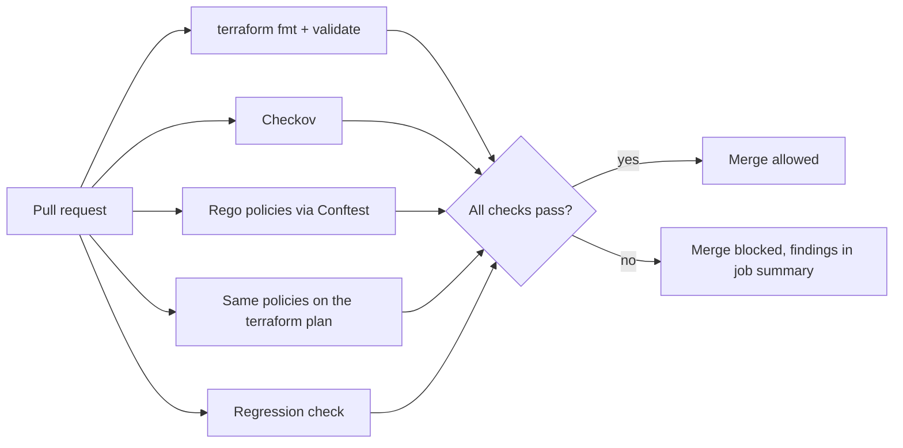

# Secure IaC Pipeline for GCP

[](https://github.com/M4ru-0x03/secure-iac-pipeline-gcp/actions/workflows/iac-security.yml)

A CI pipeline that blocks cloud misconfigurations in Terraform **before** they are deployed. Every pull request is scanned with [Checkov](https://www.checkov.io/) and eight custom [OPA/Rego](https://www.openpolicyagent.org/) policies run through [Conftest](https://www.conftest.dev/). A violation fails the check and the findings are published as a readable table.

Everything is static analysis: no cloud account, no credentials, and `terraform apply` is never run.


## The problem

Infrastructure as code turns a misconfiguration into a one-line change: an SSH rule open to `0.0.0.0/0`, a bucket granted to `allUsers`, a VM running as an over-privileged service account. Caught in review it costs a comment; caught in production it costs an incident. Reviewers miss these, and generic scanners have gaps, such as organisation-specific rules (required labels) and some encryption requirements.

This project shows a gate that catches them automatically, explains why, and is itself tested.

## How it works



| Job | What it does |
|---|---|
| **Terraform fmt and validate** | `fmt -check`, `init -backend=false` and `validate` on both the fixed and the vulnerable code. No credentials needed. |
| **Checkov** | Scans `terraform/fixed/gcp` and writes failed checks to the job summary. |
| **Rego policies** | Runs the policy unit tests (`conftest verify`), then applies the policies to `terraform/fixed/gcp`. |
| **Rego policies on the plan** | Plans `terraform/fixed/gcp` offline, converts the plan JSON, and applies the same policies to it; then requires all 8 policies to fire on the plan of the vulnerable code. See [Policies on the Terraform plan](#policies-on-the-terraform-plan). |
| **Scanners still catch the known-bad code** | Requires all 8 policies to fire on `terraform/vulnerable/gcp`, and Checkov to fail on it. A scanner that silently stops detecting would otherwise pass green. |

## Policies

Each policy has its own Rego package under [`policy/gcp/`](policy/gcp/) and unit tests next to it (61 in total), written before the policy itself.

| Policy | Blocks | Why it matters | Checkov equivalent |
|---|---|---|---|
| [`public_bucket`](policy/gcp/public_bucket.rego) | `allUsers` / `allAuthenticatedUsers` on a bucket (IAM member or binding) | Anyone on the internet can read the data | `CKV_GCP_28` |
| [`open_firewall`](policy/gcp/open_firewall.rego) | Ingress from `0.0.0.0/0` or `::/0` to SSH, RDP or all ports (port ranges are expanded, disabled rules are ignored) | Exposes administrative access to the internet | `CKV_GCP_2` and others |
| [`bucket_cmek`](policy/gcp/bucket_cmek.rego) | Bucket without a customer-managed KMS key | Key control, rotation and revocation stay with you | none found |
| [`primitive_role`](policy/gcp/primitive_role.rego) | `roles/owner`, `roles/editor`, `roles/viewer` at project, folder or organization level | Far broader than any single job needs | `CKV_GCP_117` |
| [`flow_logs`](policy/gcp/flow_logs.rego) | Subnet without `log_config` | No network telemetry for investigations | `CKV_GCP_26` |
| [`default_service_account`](policy/gcp/default_service_account.rego) | VM running as the default service account with the `cloud-platform` scope | A compromised VM can reach every API the account can | `CKV_GCP_30`, `CKV_GCP_31` |
| [`public_ip`](policy/gcp/public_ip.rego) | Instance with an `access_config` block | Gives the VM an external address | `CKV_GCP_40` |
| [`required_labels`](policy/gcp/required_labels.rego) | Buckets and VMs without non-empty `owner` and `environment` labels | Ownership and cost attribution | none found |

The last column comes from `checkov --list` on the pinned version (3.4.0). Two policies cover gaps there: bucket CMEK and organisation-specific labels.

## Before and after

[`terraform/vulnerable/gcp`](terraform/vulnerable/gcp) contains eight intentional flaws; [`terraform/fixed/gcp`](terraform/fixed/gcp) is the remediated version.

| | Vulnerable | Fixed |
|---|---|---|
| Rego policies | 9 violations (all 8 policies fire) | 0 |
| Checkov | 15 failed, 14 passed | 0 failed, 36 passed, 2 skipped with a written reason |

[Pull request #1](https://github.com/M4ru-0x03/secure-iac-pipeline-gcp/pull/1) reintroduces an open SSH rule and a public bucket into the fixed code. The run fails, and both scanners agree on the findings:


Reverting the change on the same branch turns every job green:


The regression job proves the scanners still see the known-bad code:


## Policies on the Terraform plan

The policies read the HCL by default. A plan is more accurate because Terraform has already resolved variables, so the same policies also run on `terraform show -json` output, without a cloud account: the plan is made with a fake token, with `-refresh=false`, and is never applied.

The same Terraform, evaluated in both modes (`labels = var.labels`, where the map has no `environment` key, and a firewall rule with no ports):

| | HCL | Plan |
|---|---|---|
| Firewall open to the internet on all ports | blocked | blocked |
| Labels from a variable, `environment` missing | warning: "cannot be checked statically" | **blocked**: `missing required labels: environment` |

The Rego policies are not touched. [`scripts/plan-to-input.jq`](scripts/plan-to-input.jq) converts the plan into the shape the HCL parser produces, and two differences between a plan and HCL need care:

- **Values known only after apply** are missing from the plan's `after` section. The adapter fills them with a placeholder only if the code configured the attribute (for example the KMS key of a bucket references another resource). A value the code never set but the provider computes, like the default service account email, stays absent, as in HCL. Otherwise `default_service_account` would not fire.
- **Unset attributes** appear as `null` or as empty lists (`ports: []`, `direction: null`). They are dropped, because in HCL they are absent and the policies treat absence as "all ports" or "ingress".

The adapter has its own tests in [`fixtures/plan/cases`](fixtures/plan/cases), run by `scripts/test-plan-adapter.sh`.

Planning offline has one requirement: the code must not use a data source that calls the provider API, because that needs real credentials. The fixed Terraform builds the Cloud Storage service agent address from a `project_number` variable instead of reading it with a data source.

## Run it locally

Prerequisites (the versions CI uses):

- [Terraform](https://developer.hashicorp.com/terraform/install) 1.17.1
- Conftest 0.71.1: `bash scripts/install-conftest.sh 0.71.1` (verifies the SHA256 checksum)
- Checkov 3.4.0: `pip install checkov==3.4.0`

```bash
# Same checks as CI, against the remediated code (exits 0)
bash scripts/run-checks.sh

# Against the intentionally vulnerable code (exits 1 and lists the findings)
bash scripts/run-checks.sh terraform/vulnerable/gcp

# Only the policies on the terraform plan
bash scripts/plan-check.sh terraform/vulnerable/gcp
```

Or one tool at a time:

```bash
conftest verify                                                         # policy unit tests
conftest test --all-namespaces --parser hcl2 terraform/vulnerable/gcp/*.tf
checkov -d terraform/vulnerable/gcp --framework terraform
```

`terraform init -backend=false` only downloads the provider plugin; no cloud credentials are involved.

## Repository layout

```
.github/workflows/iac-security.yml   CI pipeline
policy/gcp/                          Rego policies and their unit tests
terraform/vulnerable/gcp/            Known-bad Terraform (the "before")
terraform/fixed/gcp/                 Remediated Terraform (the "after")
scripts/                             Local runner, plan check, plan adapter, Conftest installer
fixtures/plan/cases/                 Test cases for the plan adapter
docs/                                Evidence (Checkov output) and screenshots
```

## Design decisions

- **Static analysis only.** Conftest reads the HCL directly through its `hcl2` parser, so no credentials are needed; the plan mode adds a second view with variables resolved, still without a cloud account.
- **An adapter, not a second set of policies.** The plan is converted to the HCL shape, so there is one implementation of each policy and one set of unit tests.
- **One Rego package per policy.** Tests are isolated and a policy can be disabled on its own. The cost is running `conftest test` with `--all-namespaces`.
- **Tests first, including the allowed cases.** Each policy has tests for what must be flagged and for what must pass (for example SSH from a private range, or a dedicated service account with the `cloud-platform` scope).
- **The pipeline tests itself.** The regression job guards against a policy that silently stops firing.
- **Pinned supply chain.** Tool versions are fixed, actions are pinned by commit SHA, the workflow token is read-only, and the Conftest download is checksum-verified.
- **Skips are written down.** Two Checkov checks are skipped inline in the Terraform with a reason: `CKV_GCP_62` on the bucket that receives the access logs (logging into itself would be circular), and `CKV_GCP_38` because a customer-supplied disk key is secret material that cannot live in a repository.

## Limitations

- Coverage is limited to the resource types the eight policies check; other Google Cloud resources are not evaluated.
- Labels set through a variable or expression (`labels = var.labels`) cannot be read from the HCL, so there `required_labels` reports a warning (visible in the job summary, not blocking). The plan mode resolves them and checks them for real.
- The plan mode needs code that can be planned offline: a data source that calls the provider API fails without credentials.
- `flow_logs` checks that logging is enabled, not its sampling or aggregation settings.
- Each file is evaluated on its own, so a rule that needs two resources together is not possible without Conftest's `--combine`.

## License

[MIT](LICENSE)
